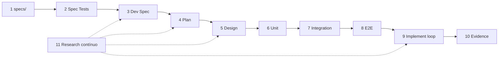

# Guia de uso — SDD Dev Kit

Documentação técnica rápida: o que o kit faz, o que **você** edita, e o que esperar em cada passo.

> Exemplos reais: [`examples/coupon-checkout`](../examples/coupon-checkout/) · fixtures em [`docs/exemplos/`](./exemplos/)

---

## 1. O que é

O **SDD Dev Kit** (Spec-Driven Development Protocol Kit) transforma cenários em português (`prosa` + `Dado`/`Quando`/`Então`) em testes executáveis, plano técnico, código e evidência para PO/BO/QA — orquestrado pelo agente de IA (Cursor, Claude ou Copilot).

| Você faz | O kit / agente faz |
|----------|-------------------|
| Escreve e refining `specs/*.md` (+ opcionalmente `.sdd/premises.md`) | Gera Spec Tests, Dev Spec, plano, design, unit/integration/e2e |
| Aceita a intenção de negócio (único gate humano) | Implementa até todos os níveis de teste passarem |
| Reporta bugs em `.sdd/bugs/<id>/REPORT.md` | Reproduce → debug → fix → QA + evidence |
| Roda `/sdd run` (ou equivalente) | Evidence pack + (opcional) `docs/sdd/` |

**Regra de ouro:** não edite à mão `tests/**`, `.sdd/dev-spec.md`, `.sdd/implementation-plan.md`, `.sdd/design-approach.md` nem o código de produção para “fazer a suíte passar”. Se o comportamento estiver errado, ajuste **`specs/`** e rode de novo.

---

## 2. Pré-requisitos

| Item | Detalhe |
|------|---------|
| **Node.js** | `>= 20` |
| **Registry** | GitHub Packages, scope `@rogeriobatista` |
| **Token** | PAT / `GITHUB_TOKEN` com pelo menos `read:packages` (nunca commitado) |
| **Host de IA** | Cursor **ou** Claude (VS Code / Claude Code) **ou** GitHub Copilot |
| **Opcional (tickets)** | `LINEAR_API_KEY` e/ou `JIRA_BASE_URL` + `JIRA_API_TOKEN` (+ `JIRA_EMAIL` no Cloud) |
| **Opcional (UI)** | Chromium via Playwright (`npx playwright install chromium`) |

Sem registry + token: `npm i` / `npx` falha com **404** (scope no npmjs) ou **401** (pacote privado sem auth).

---

## 3. Instalação rápida

### 3.1 `.npmrc` (obrigatório para Packages)

Crie `~/.npmrc` ou `.npmrc` no projeto (não cole o valor do token no arquivo):

```ini
@rogeriobatista:registry=https://npm.pkg.github.com
//npm.pkg.github.com/:_authToken=${GITHUB_TOKEN}
```

```bash
# PowerShell
$env:GITHUB_TOKEN = "ghp_…"   # só no ambiente; nunca no git

# bash
export GITHUB_TOKEN=ghp_…
```

### 3.2 CLI

```bash
npm i -g @rogeriobatista/cli
sdd init --host cursor --stack typescript
```

Ou one-shot:

```bash
npx @rogeriobatista/cli init --host all --stack typescript
```

### 3.3 Alternativa sem Packages

Clone este repositório:

```bash
npm run setup
npx sdd init --host cursor --stack typescript
```

Cloud Agents: ver [cloud-agents.md](./cloud-agents.md).

---

## 4. Fluxo dos 11 passos

1. **Humano** — NL + BDD em `specs/`
2. **Kit** — Spec Tests executáveis (`tests/features` ou `tests/spec`)
3. **Kit** — Dev Spec → `.sdd/dev-spec.md`
4. **Kit** — Implementation Plan → `.sdd/implementation-plan.md`
5. **Kit** — Design & Approach → `.sdd/design-approach.md`
6. **Kit** — Unit → `tests/unit/`
7. **Kit** — Integration → `tests/integration/`
8. **Kit** — E2E → `tests/e2e/`
9. **Kit** — Implementar até todos os níveis verdes
10. **Kit** — Evidence → `.sdd/evidence/<key>/latest/`
11. **Kit** — Best practices contínuas → `.sdd/research/<key>/` (não é um “stop” separado)



```text
você: specs/  ──aceitar──▶  /sdd run  ──auto──▶  2→10 (até verde ou cap)
                                              │
                              step 11 (research) em paralelo nas dúvidas
```

---

## 5. Passo a passo hands-on (cupom / checkout)

Use o exemplo [`examples/coupon-checkout`](../examples/coupon-checkout/) ou um projeto após `sdd init`.

### Passo 1 — Spec completa (humano)

Arquivo: `specs/checkout-cupom.md`  
Fixture: [`docs/exemplos/specs-checkout-cupom.md`](./exemplos/specs-checkout-cupom.md)

```markdown
# Checkout — aplicar cupom

## Intenção
Permitir aplicar um cupom percentual no carrinho antes do pagamento.
Cupons expirados ou inválidos não alteram o total.

## Cenários

### Cupom válido reduz o total @api
Dado um carrinho com total 100
E um cupom "PROMO10" de 10% válido
Quando o usuário aplica o cupom
Então o total deve ser 90
E o recibo deve mostrar o desconto aplicado

### Cupom expirado é rejeitado @api
Dado um carrinho com total 100
E um cupom "OLD10" expirado
Quando o usuário aplica o cupom
Então o total permanece 100
E uma mensagem de erro clara é retornada

### Cupom válido aparece na tela de checkout @ui
Dado que o usuário está no checkout com total 100
E um cupom "PROMO10" de 10% válido está disponível
Quando o usuário informa o cupom e confirma
Então a tela mostra total 90
E exibe o desconto aplicado
```

Declare a stack em `.sdd/premises.md`:

```markdown
## Stack
- adapter: typescript
- Cucumber para @api · Playwright para @ui / @e2e
```

Depois: **`/sdd run`** (Cursor) · `SDD: run` (Claude/Copilot) · `sdd run` (CLI status/guidance).

---

### Passos 2–8 — Outputs esperados (snippets)

#### Passo 2 — Spec Tests (`tests/features/checkout-cupom.feature`)

```gherkin
# language: pt
Funcionalidade: Checkout — aplicar cupom

  @api
  Cenário: Cupom válido reduz o total
    Dado um carrinho com total 100
    E um cupom "PROMO10" de 10% válido
    Quando o usuário aplica o cupom
    Então o total deve ser 90
    E o recibo deve mostrar o desconto aplicado
```

Steps gerados tipicamente em `tests/steps/checkout-cupom.steps.ts`.

#### Passo 3 — `.sdd/dev-spec.md`

```markdown
# Dev Spec

## Scope
Aplicar cupom percentual no checkout; rejeitar cupons expirados/inválidos.

## Interfaces & contracts
- Domínio: `applyCoupon(cartTotal, code) → { total, discount?, error? }`
- UI: campo Cupom + botão Aplicar; `#total`, `#receipt` / `#message`

## Acceptance mapping
| Cenário | Tag | Camada |
|---------|-----|--------|
| Cupom válido reduz o total | @api | Spec Tests |
| Cupom válido aparece na tela | @ui | E2E |
```

#### Passo 4 — `.sdd/implementation-plan.md`

```markdown
# Dev Implementation Plan

## Tasks
1. Função de domínio `applyCoupon` + regras PROMO10 / OLD10 — cite `be-ts-handbook`
2. Endpoint / handler HTTP mínimo para o checkout
3. UI mínima (label Cupom, botão, total, recibo/erro)
4. Fechar Spec Tests @api e E2E @ui

## Verify layers
- [ ] Spec Tests (`tests/features`)
- [ ] Unit (`tests/unit`)
- [ ] Integration (`tests/integration`)
- [ ] E2E (`tests/e2e`)
```

#### Passo 5 — `.sdd/design-approach.md`

```markdown
# Design & Approach

## Approach
Validar cupom no backend/domínio; a UI só reflete o resultado.

## Architecture
`src/coupon.ts` (regras) → `src/server.ts` (HTTP/UI) → testes Spec + E2E

## Trade-offs
Simplicidade no exemplo (mapa de cupons em memória) vs serviço externo de promoções.
```

#### Passo 6 — Unit (`tests/unit/…`)

```typescript
// tests/unit/coupon.test.ts (exemplo)
import { describe, it, expect } from "vitest"; // ou node:test
import { applyCoupon } from "../../src/coupon.js";

describe("applyCoupon", () => {
  it("PROMO10 reduz 100 → 90", () => {
    expect(applyCoupon(100, "PROMO10").total).toBe(90);
  });
});
```

#### Passo 7 — Integration (`tests/integration/…`)

```typescript
// tests/integration/checkout-coupon.test.ts (exemplo)
it("POST aplica cupom e devolve recibo", async () => {
  const res = await fetch("http://127.0.0.1:4173/api/coupon", {
    method: "POST",
    headers: { "content-type": "application/json" },
    body: JSON.stringify({ total: 100, code: "PROMO10" }),
  });
  expect((await res.json()).total).toBe(90);
});
```

#### Passo 8 — E2E (`tests/e2e/checkout-cupom.spec.ts`)

```typescript
import { test, expect } from "@playwright/test";

test("Cupom válido aparece na tela de checkout", async ({ page }) => {
  await page.goto("/");
  await page.getByLabel("Cupom").fill("PROMO10");
  await page.getByRole("button", { name: "Aplicar cupom" }).click();
  await expect(page.locator("#total")).toHaveText("90");
  await expect(page.locator("#receipt")).toContainText("Desconto");
});
```

---

### Passo 9 — Auto-loop (implement → verify → diagnose)

O que faz:

1. Implementa código de produção para deixar testes vermelhos → verdes  
2. Roda runners de `sdd.yaml` (spec / unit / integration / e2e)  
3. Se falhar: diagnostica e tenta de novo (até `loop.maxDiagnoseIterations`, default **3**)

Para quando:

| Condição | Resultado |
|----------|-----------|
| Todos os níveis verdes | Segue para evidence (passo 10) |
| Cap de diagnose atingido | Relatório em `.sdd/runs/` — não pede para você “consertar o código” |
| Spec ambígua / regra faltando | **Para** e pede ajuste em `specs/` (único gate humano) |

---

### Passo 10 — Evidence (PO / BO / QA)

Caminho canônico:

```text
.sdd/evidence/<key>/latest/demo/
  index.html      ← abrir no browser (offline)
  SUMMARY.md      ← colar em Slack/e-mail
  manifest.json   ← lista machine-readable
  evidence/       ← artefatos de teste (cucumber, playwright, …)
```

`<key>` = ticket (`linear:ENG-42`) ou id estável local (`.sdd/evidence-id.json`).

**`index.html`** — página de demo com cenários em linguagem de negócio (sem dump de código, sem secrets).  
**`SUMMARY.md`** — resumo curto do que passou/falhou alinhado às specs.

Comandos: `/sdd demo` · `sdd demo` · no exemplo: `npm run sdd:demo -w coupon-checkout`.

---

### Passo 11 — Research / best practices

Não é uma fase “no fim”. Durante 2–10, em caso de dúvida técnica, o agente consulta o catálogo e escreve:

```text
.sdd/research/<key>/BEST_PRACTICES.md
.sdd/research/<key>/sources.json
```

Cita fontes no Dev Spec / Plan / Design. Premises vencem em conflito. Standalone: `/sdd research`.

---

## 6. from-ticket (Linear / Jira)

Bootstrap de `specs/` a partir do ticket — **depois pausa** para você revisar (gate humano).

```text
/sdd from-ticket linear:ENG-42
# revise specs/checkout-….md
/sdd run
```

```text
SDD: from-ticket jira:SHOP-7
sdd from-ticket ENG-42 --run   # só entra no auto-loop se a draft já for completa
```

Env (nunca no argv / nunca no repo):

| Provider | Variáveis |
|----------|-----------|
| Linear | `LINEAR_API_KEY` |
| Jira | `JIRA_BASE_URL`, `JIRA_API_TOKEN`, `JIRA_EMAIL` (Cloud) |

**Output típico**

```text
specs/ENG-42-checkout-aplicar-cupom.md   ← draft NL + Dado/Quando/Então
.sdd/ticket.json                         ← provenance + evidenceKey
```

O agente **não inventa** critérios que não estão no ticket. Fixtures offline: `packages/core/src/ticketing/fixtures/`.

---

## 7. Bugfix (mini fluxo)

```text
bug report → reproduce (teste vermelho) → debug → fix → qa (+ evidence)
```

```text
/sdd bug report linear:ENG-99
/sdd reproduce linear:ENG-99
/sdd debug linear:ENG-99
/sdd fix linear:ENG-99
/sdd qa linear:ENG-99
```

**Hard rule:** nunca `fix` sem regressão falhando de `reproduce`.

Exemplo `.sdd/bugs/linear-ENG-99/REPORT.md` — fixture completa: [`docs/exemplos/REPORT-bug-cupom.md`](./exemplos/REPORT-bug-cupom.md)

```markdown
| Campo | Valor |
|-------|-------|
| **ID** | linear:ENG-99 |
| **Severidade** | alta |

## Resumo
Cupom válido PROMO10 não atualiza o total na tela.

## Passos para reproduzir
1. Abrir checkout com total 100
2. Informar PROMO10 e aplicar

## Comportamento esperado
Total 90 e desconto no recibo

## Comportamento atual (erro)
Total permanece 100
```

Artefatos: `REPORT.md` (humano) · `DEBUG.md` / `QA.md` / `meta.json` (agente).

---

## 8. Docs (`sdd docs`)

Opcional **depois** da evidence. Gera pack profissional **sem inventar features** fora de `specs/`.

```text
sdd docs
sdd docs handoff
/sdd docs
```

```text
docs/sdd/
  README.md  PRODUCT.md  TECHNICAL.md  CHANGELOG.md  HANDOFF.md  ADR/  API.md
```

Snippet típico de `docs/sdd/HANDOFF.md`:

```markdown
# Handoff — PO / BO / QA / Desenvolvimento

## Resumo para o solicitante
Checkout com cupom percentual (PROMO10) e rejeição de cupom expirado (OLD10).

## O que foi pedido
Permitir aplicar um cupom percentual no carrinho antes do pagamento.

## Como validar (PO / BO / QA)
1. Abra o demo pack: `.sdd/evidence/<key>/latest/demo/`
2. Confira os cenários em PRODUCT.md
3. Compare com a intenção original nas specs — **não** aceite comportamento inventado fora de `specs/`
```

---

## 9. Cheatsheet de comandos

| Intent | Cursor | Claude | Copilot | CLI |
|--------|--------|--------|---------|-----|
| Init | `/sdd init` | `SDD: init` | `SDD: init` / `/sdd-init` | `sdd init` |
| From ticket | `/sdd from-ticket <id>` | `SDD: from-ticket <id>` | `SDD: from-ticket` | `sdd from-ticket` |
| Run | `/sdd run` | `SDD: run` | `SDD: run` / `/sdd-run` | `sdd run` |
| Research | `/sdd research` | `SDD: research` | `SDD: research` | (host) |
| Verify | `/sdd verify` | `SDD: verify` | `SDD: verify` | `sdd verify` |
| Demo | `/sdd demo` | `SDD: demo` | `SDD: demo` | `sdd demo` |
| Docs | `/sdd docs` | `SDD: docs` | `SDD: docs` | `sdd docs` |
| Status | `/sdd status` | `SDD: status` | `SDD: status` | `sdd status` |
| Bug report | `/sdd bug report` | `SDD: bug report` | `SDD: bug report` | `sdd bug-report` |
| Reproduce | `/sdd reproduce` | `SDD: reproduce` | `SDD: reproduce` | `sdd reproduce` |
| Debug | `/sdd debug` | `SDD: debug` | `SDD: debug` | `sdd debug` |
| QA | `/sdd qa` | `SDD: qa` | `SDD: qa` | `sdd qa` |
| Fix | `/sdd fix` | `SDD: fix` | `SDD: fix` | `sdd fix` |

Stacks: `typescript` · `python` · `react-vite` · `node-graphql` · `terraform`

---

## 10. O que esperar / non-goals / falhas comuns

### O que esperar

- Você itera **só** em `specs/` (e premises / REPORT de bug)
- `/sdd run` automatiza 2–10 até verde ou cap; não pede “corrija o código”
- Evidence e docs falam a linguagem das specs (PT), sem secrets
- Stack vem de premises/specs — se ambígua, o kit **para** e pergunta

### Non-goals (MVP)

- Watch automático em `specs/**` (default `triggers.watch: false`)
- Inventar regras de negócio ausentes no ticket/specs
- Apply Terraform na nuvem / credenciais de cloud no verify padrão
- Write-back de status para Linear/Jira

### Falhas comuns

| Sintoma | Causa provável | O que fazer |
|---------|----------------|-------------|
| `401` no `npm i` / `npx` | Token ausente/inválido | Exporte `GITHUB_TOKEN` com `read:packages`; confira a 2ª linha do `.npmrc` |
| `404` no `@rogeriobatista/*` | Scope no registry errado | Confira `@rogeriobatista:registry=https://npm.pkg.github.com` |
| Stack “needs clarification” | Premises/specs sem `## Stack` | Declare um adapter em `.sdd/premises.md` |
| Loop para pedindo specs | Critério ambíguo / faltando | Enriqueça `specs/` — não patch em testes gerados |
| `from-ticket` sem AC | Ticket sem critérios | Complete à mão em `specs/` antes do `run` |
| `fix` recusado | Sem regressão vermelha | Rode `reproduce` primeiro |
| Playwright falha sem browser | Chromium não instalado | `npx playwright install chromium` ou `npm run setup` |

---

## Referências rápidas

| Recurso | Path |
|---------|------|
| Exemplo TS (cupom) | [`examples/coupon-checkout`](../examples/coupon-checkout/) |
| Fixtures deste guia | [`docs/exemplos/`](./exemplos/) |
| Cloud Agents | [`docs/cloud-agents.md`](./cloud-agents.md) |
| Design 11 passos | [`docs/superpowers/specs/2026-11-25-sdd-canonical-11-step-flow-design.md`](./superpowers/specs/2026-11-25-sdd-canonical-11-step-flow-design.md) |
| README do kit | [`README.md`](../README.md) |
