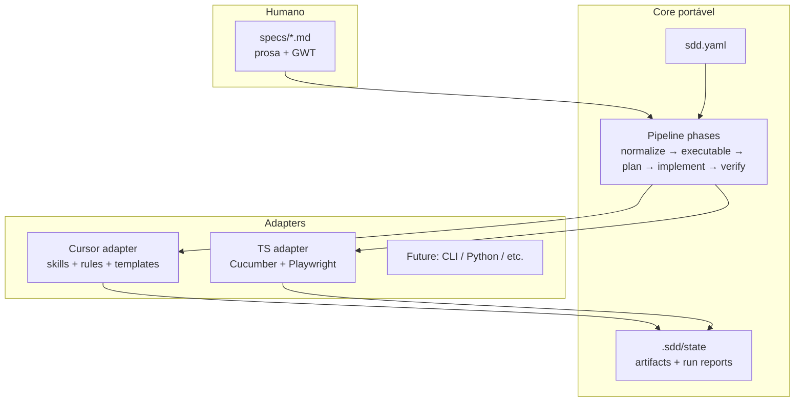
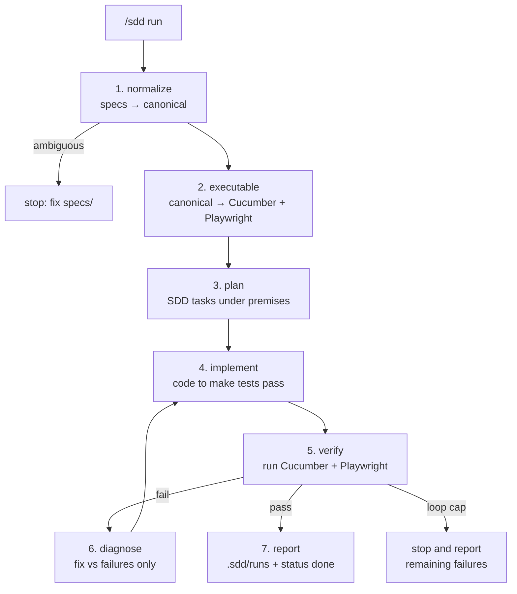

# SDD Dev Kit — Design

**Date:** 2026-11-24  
**Status:** Approved  
**Form:** Protocol Kit híbrido (core portável + adapters)

## Goal

Entregar um kit reutilizável onde o humano só edita `specs/*.md` (prosa + Given/When/Then em português) e um pipeline AI-driven normaliza, gera Cucumber/Playwright, planeja (SDD), implementa e verifica até os testes passarem.

## Locked decisions

| Topic | Choice |
|-------|--------|
| Forma | Híbrido: core + adapters; Cursor primeiro; CLI depois |
| Specs NL | Formato D: prosa para intenção + blocos Given/When/Then |
| Stack MVP | TypeScript com Cucumber **e** Playwright já plugados |
| Trigger | Comando explícito (`/sdd run`); `triggers.watch` no schema com default `false` |
| Abordagem | Protocol Kit (contrato versionado + skills Cursor + adapter TS) |

## Architecture

Three layers:



- **Core** defines the contract (folders, phases, artifacts, status). It does not know TypeScript or Cursor.
- **Cursor adapter** orchestrates the LLM via skills/rules.
- **TS adapter** materializes Cucumber features/steps + Playwright and runs the suite.

### Target project tree (after `/sdd init`)

```text
my-app/
  specs/                 # ONLY human-edited area (NL)
  .sdd/
    premises.md          # project rules (stack, style, constraints)
    canonical/           # normalized scenarios
    plan/                # generated SDD plan
    runs/                # execution reports
  tests/
    features/            # generated .feature (do not hand-edit)
    steps/               # generated step defs
    e2e/                 # generated Playwright
  src/                   # production code produced/adjusted by the agent
  sdd.yaml               # adapter, runners, paths, triggers
```

**Golden rule:** humans edit only `specs/` (+ `.sdd/premises.md` when changing project rules). Features, steps, plan, and code are pipeline outputs.

## Spec format (NL)

Markdown files. One file = one business capability.

```markdown
# Checkout — aplicar cupom

## Intenção
Permitir aplicar um cupom percentual no carrinho antes do pagamento.
Cupons expirados ou inválidos não alteram o total.

## Cenários

### Cupom válido reduz o total @api
Dado um carrinho com total 100
E um cupom "PROMO10" de 10% válido
Quando o usuário aplica o cupom
Então o total deve ser 90
E o recibo deve mostrar o desconto aplicado

### Cupom expirado é rejeitado @ui
Dado um carrinho com total 100
E um cupom "OLD10" expirado
Quando o usuário aplica o cupom
Então o total permanece 100
E uma mensagem de erro clara é exibida
```

Rules:

- Prose under `## Intenção` (and free notes) — context for the agent
- Scenarios under `###` with Portuguese GWT: `Dado` / `Quando` / `Então` / `E`
- Optional tags in the title: `@api`, `@ui`, `@e2e`
- No code, no technical asserts, no class names

### Tag routing

| Tag | Runner |
|-----|--------|
| `@api` | Cucumber |
| `@ui` / `@e2e` | Playwright (+ Cucumber if premises require) |
| (none) | Cucumber by default unless premises say otherwise |

### Generated artifacts (not hand-edited)

1. Canonical scenarios (`.sdd/canonical/*.json`)
2. Cucumber (`tests/features/*.feature` + `tests/steps/*`)
3. Playwright (`tests/e2e/*`) for `@ui`/`@e2e`

### Normalization

`normalize` reads `specs/`, resolves ambiguity via `.sdd/premises.md`, and writes canonical JSON. If incomplete for a testable scenario, the pipeline **stops and asks for clarification in `specs/`** — it never invents business rules.

## Pipeline (SDD loop)

MVP trigger: explicit Cursor skill `/sdd run`. Watch exists only in the contract (`triggers.watch: false` by default).



| Phase | Input | Output | Rule |
|-------|-------|--------|------|
| normalize | `specs/`, premises | `.sdd/canonical/` | Do not invent business rules |
| executable | canonical | `tests/features`, `steps`, `e2e` | Regenerable; humans do not edit |
| plan | canonical + premises + current code | `.sdd/plan/` | Small, ordered, testable tasks |
| implement | plan + red tests | `src/` | TDD: tests first, code second |
| verify | adapter runners | `.sdd/runs/<id>/` | Exit code + structured report |
| diagnose | failures | patch plan | Fix implementation; if spec is wrong, stop |

### Guardrails

- Max **3** diagnose→implement iterations per run
- Agent must **not** edit `specs/` without explicit human request
- Premises own stack, folders, style, and `@ui` vs domain routing
- Product failure ≠ spec failure: if the test is right and code is wrong, only code changes

## Adapter TypeScript

- **Cucumber** (`@cucumber/cucumber`): features/steps from canonical; domain/`@api` without browser when possible
- **Playwright**: `@ui`/`@e2e`; helpers under `tests/e2e/`
- **Vitest**: out of MVP as primary runner
- Scripts in `sdd.yaml`: `verify.cucumber`, `verify.playwright`, `verify.all`
- Responsibilities: scaffold + materialize + execute — **no LLM orchestration**

## Adapter Cursor (MVP orchestration)

- Skill `/sdd` with `init | from-ticket | run | verify | status`
- Rules: humans edit only `specs/` (+ premises); do not ask humans to edit features/steps/code
- Templates: `specs/_example.md`, `.sdd/premises.md`, `sdd.yaml`
- Ticket bootstrap: `/sdd from-ticket` (Linear + Jira) — see [2026-11-24-sdd-ticketing-design.md](./2026-11-24-sdd-ticketing-design.md)
- Optional phase-2 hook: watch `specs/**` → suggest `/sdd run`

## Kit repository layout

```text
sdd-dev-kit/
  packages/
    core/                 # sdd.yaml schema, phases, artifacts, status
    adapter-ts/           # Cucumber + Playwright scaffold + runners
    adapter-cursor/       # skills, rules, templates
  examples/
    coupon-checkout/      # minimal TS app validating the loop
  docs/
    superpowers/specs/    # design docs
    superpowers/plans/    # implementation plans
  README.md
```

## MVP scope

1. Core contract (`sdd.yaml` schema + folders + phase status)
2. Cursor adapter (`init` + `run` complete)
3. TS adapter with Cucumber and Playwright plugged
4. Example `coupon-checkout`
5. Docs: how to use in any TS project

## Out of MVP (roadmap only)

- Standalone CLI `sdd`
- Automatic watch
- Python / Java adapters
- Vitest as a third track
- Cloud / CI agent runner

## Success criteria

Human writes/adjusts only `specs/*.md` in the example, runs `/sdd run`, and ends with green Cucumber + Playwright — without hand-editing features, steps, or `src/`.
