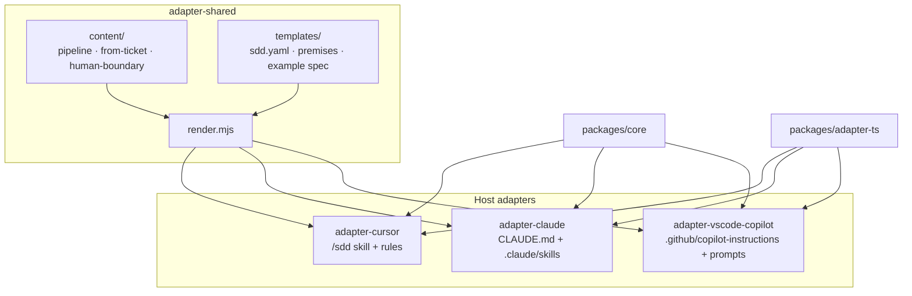

# SDD Multi-Host Adapters — Design

**Date:** 2026-11-24  
**Status:** Approved  
**Form:** Protocol Kit — portable core + shared instruction content + thin host adapters

## Goal

Keep one Spec-Driven Development Protocol Kit usable from **Cursor**, **Claude (VS Code / Claude Code)**, and **GitHub Copilot (VS Code)** without forking pipeline semantics.

## Locked decisions

| Topic | Choice |
|-------|--------|
| Core | Unchanged: `packages/core` owns `sdd.yaml`, phases, ticketing |
| Shared prompts | `packages/adapter-shared` — single markdown source + scaffold templates |
| Host adapters | `adapter-cursor` (existing), `adapter-claude` (new), `adapter-vscode-copilot` (new) |
| Delivery | Instruction packs / templates only — **no** VS Code extension |
| DRY | Host files are **rendered** from shared content via `scripts/render.mjs` |
| Commands | Same intents everywhere: init \| from-ticket \| run \| verify \| status |

## Architecture

## Host command map

| Intent | Cursor | Claude | Copilot |
|--------|--------|--------|---------|
| Init | `/sdd init` | `SDD: init` | `SDD: init` / `/sdd-init` |
| From ticket | `/sdd from-ticket <id>` | `SDD: from-ticket <id>` | `SDD: from-ticket <id>` / `/sdd-from-ticket` |
| Run | `/sdd run` | `SDD: run` | `SDD: run` / `/sdd-run` |
| Verify | `/sdd verify` | `SDD: verify` | `SDD: verify` / `/sdd-verify` |
| Status | `/sdd status` | `SDD: status` | `SDD: status` / `/sdd-status` |

## Install paths (target project)

| Host | Files to copy |
|------|----------------|
| Cursor | `skills/sdd/` → `.cursor/skills/sdd/`; `rules/sdd-human-edits.mdc` → `.cursor/rules/` |
| Claude | `CLAUDE.md` + `.claude/skills/sdd/` |
| Copilot | `.github/copilot-instructions.md` + `.github/prompts/sdd-*.prompt.md` |

Scaffold (`sdd.yaml`, premises, example spec) always comes from `adapter-shared/templates/` (also mirrored under `adapter-cursor/templates/` after render).

## Ticketing / MCP

| Host | Preferred | Fallback |
|------|-----------|----------|
| Cursor | MCP Linear/Jira | `@rogeriobatista/core` providers + env vars |
| Claude | MCP Linear/Jira | same core providers |
| Copilot | Often **no** MCP parity | **REST/GraphQL via core + env vars** — document as a known gap |

Secrets never in repo or argv; env var **names** only in `sdd.yaml`.

## Non-goals (YAGNI)

- Standalone CLI (still roadmap)
- Full VS Code extension
- Divergent per-host pipeline phases
- Writing secrets or live tokens into adapter files

## Tests

`packages/adapter-shared` unit tests assert required sections exist in shared content and in each rendered host pack: pipeline phases (normalize…report), from-ticket, human edit boundary (`specs/` + Portuguese GWT).

## Compatibility

- Must not break existing Cursor skill/rules behavior or `examples/coupon-checkout`.
- Cursor mental model stays `/sdd`; other hosts use documented natural-language / prompt equivalents.
