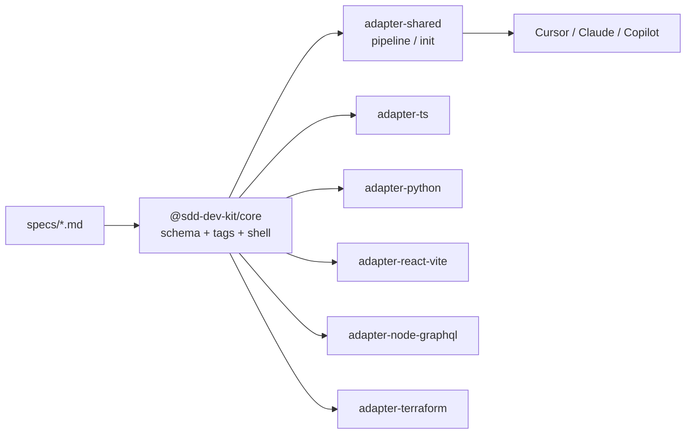

# SDD stack adapters — Design

**Date:** 2026-11-24  
**Status:** Approved  
**Form:** Portable core + first-class stack adapters under `packages/`

## Goal

Support the user’s real project types with the same Spec-Driven Development contract (NL `specs/` → canonical → executable tests → plan → implement → verify), without forking the core protocol per language.

## First-class stacks

| Id (`sdd.yaml` `adapter`) | Package | Verify path |
|---------------------------|---------|-------------|
| `typescript` (alias `ts`) | `@sdd-dev-kit/adapter-ts` | Cucumber + Playwright |
| `python` | `@sdd-dev-kit/adapter-python` | pytest |
| `react-vite` | `@sdd-dev-kit/adapter-react-vite` | Playwright (+ optional Vitest) |
| `node-graphql` | `@sdd-dev-kit/adapter-node-graphql` | Cucumber and/or Vitest |
| `terraform` | `@sdd-dev-kit/adapter-terraform` | `terraform fmt` / `validate` / `test` (no apply) |

Optional nested form (backward compatible):

```yaml
adapter: typescript          # still valid
# or:
adapters:
  stack: python
  hosts: [cursor, claude]
```

When `adapters.stack` is set, it overrides top-level `adapter`.

## Architecture



- **Core** owns `sdd.yaml` schema (adapter ids + flexible runners), shared tag helpers (`usesCucumber` / `usesPlaywright` / `slugifyScenarioBase`), and `runShellCommand`.
- **Stack adapters** own scaffold templates, canonical→test materialize, and verify wiring only.
- **Host adapters** stay stack-agnostic: init asks for stack; verify reads `runners.*` from the manifest.

## DRY rules

- Tag routing and slugify live in core (re-exported by `adapter-ts` for compatibility).
- Playwright stub style for `react-vite` mirrors `adapter-ts` (same comments / `page.goto` TODO pattern).
- Shell execution is shared via `runShellCommand` — each adapter only picks which runner key to run.

## Terraform safety

Default verify **must not** require cloud credentials:

1. `terraform fmt -check`
2. `terraform init -backend=false && terraform validate`
3. `terraform test` (`.tftest.hcl`)

No `terraform apply` in default runners. Examples use `null` / local-only providers.

## Examples

| Example | Smoke |
|---------|-------|
| `examples/coupon-checkout` | Cucumber + Playwright (existing) |
| `examples/python-pytest-hello` | `pytest -q` |
| `examples/react-vite-playwright` | Playwright against Vite |
| `examples/node-graphql-api` | Vitest (+ Cucumber) |
| `examples/terraform-module` | `terraform test` |

## Non-goals

- Standalone CLI (still roadmap)
- File watch as default trigger
- Cloud apply / secretful Terraform CI in the kit defaults
